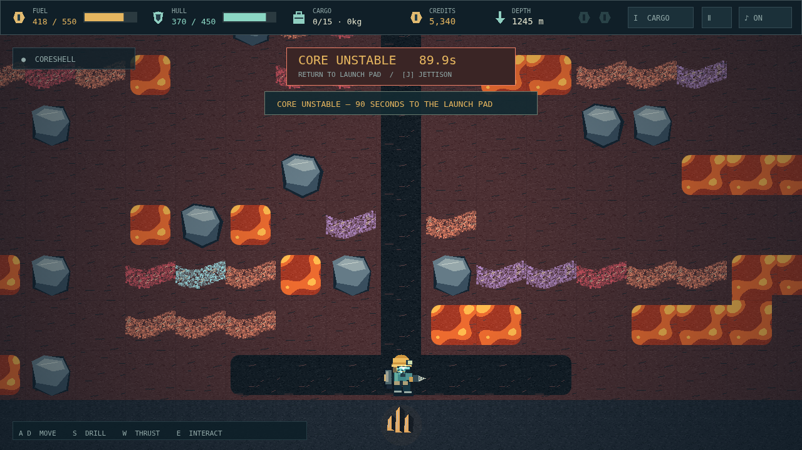

# Deepcore

A dead mining world. A working drill. One way out. In **Deepcore**, you are a lone prospector turning the ground beneath your boots into an escape rocket. Every expedition begins at a quiet salvage camp and ends with a decision: one more vein, or the climb home?

Cut a shaft through warm topsoil, follow mineral seams into cold rock, and fill your cargo bay with increasingly valuable finds. Then fire your jetpack and haul them back to the market. Ore buys fuel, repairs, a stronger drill, a larger bay, and the parts of your rocket. But wealth has weight: a heavy haul climbs slowly, and an overloaded suit cannot lift at all.

Below the familiar stone, pale gas wisps hint at violent pockets and molten pools force you to change course. Bring explosives for stubborn boulders, emergency supplies for bad decisions, and a scanner to hunt the crystals your rocket needs. At the planet's Core, your final prize starts a ninety-second countdown. The way home becomes a race.

Choose a short descent or a marathon mine, and decide what failure costs. Standard preserves your last save; Hardcore erases it. Either way, the Save Pad is back at camp, the fuel in your tank is all you have, and the rocket only leaves when you finish building it.

